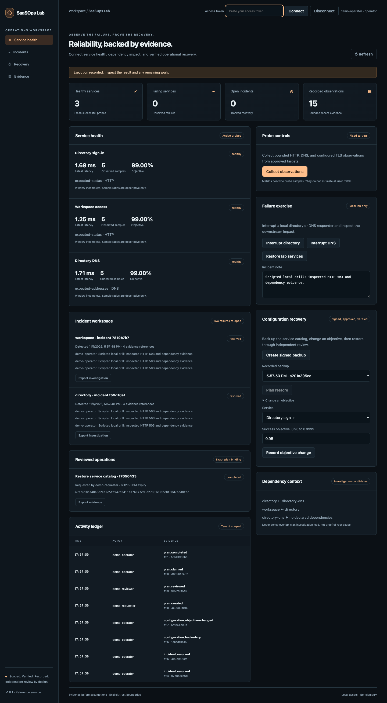
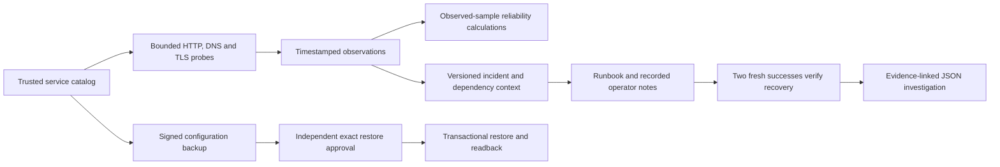

# SaaSOps Reliability Lab

**Observe failures, investigate dependency impact, and prove operational recovery.**

A service catalog and incident workbench with bounded HTTP, DNS and TLS probes, sample-based reliability calculations, evidence-linked incident transitions, signed configuration backups and independently approved restore. The complete fault-and-recovery demo runs locally without SaaS credentials or cloud infrastructure.

[](https://github.com/jayekwere/saasops-reliability-lab/actions/workflows/verify.yml) [MIT](LICENSE)



## Run the drill

Requires Node 24.13 or later through Node 26 and OpenSSL for the real TLS test fixtures. Docker supplies the test dependency in its build stage.

```sh
git clone https://github.com/jayekwere/saasops-reliability-lab.git
cd saasops-reliability-lab
npm ci --ignore-scripts
npm run build
npm run demo
DEMO=1 npm start
```

Open **http://127.0.0.1:4430**. Connect the operator token from the terminal and collect observations. Interrupt the local directory, then collect twice, spacing requests by at least half a second. Directory and workspace incidents open with probe evidence and a dependency lead. Add an incident note, acknowledge and start monitoring. A premature close is denied. Restore lab services and collect two fresh successes before resolving each case.

Create a signed backup, change an objective, connect the requester token to plan restore, the reviewer token to approve, and the operator token to execute. The restored catalog is read back and fingerprinted. Browser and CLI demos exercise these actual routes.

`docker compose up --build` provides the same private HTTP/DNS fault lab in a non-root read-only container. Inspect disposable tokens with `docker compose logs`; stop it with `docker compose down`. No public service, DNS zone, cloud resource or SaaS configuration is changed.

## Implemented behavior

| Area                  | Working implementation                                                                                                                                          |
| --------------------- | --------------------------------------------------------------------------------------------------------------------------------------------------------------- |
| Service catalog       | Strict HTTP/DNS/TLS targets, bounded intervals/objectives, explicit dependencies and cycle rejection                                                            |
| Probes                | Actual GET status, A-record validation, trusted TLS hostname/expiry checks, timeouts and latency observations                                                   |
| Network boundary      | Server-owned targets, rejected URL credentials/query/fragment, public-address checks in configured mode, resolved-address socket pinning, no redirect following |
| Reliability           | Last-hour retained probe-sample success ratio, budget and burn calculations; no-data/stale states and incomplete-window labels                                  |
| Incidents             | Two recent consecutive failures to open, unresolved duplicate suppression, versioned acknowledge/monitor/resolve workflow                                       |
| Recovery verification | Two fresh successes after detection required for closure, with exact evidence references                                                                        |
| Dependencies          | Explicit failing-dependency overlap labeled as a candidate, never an automatic root-cause verdict                                                               |
| Configuration         | Domain-separated HMAC backup, exact approved before-state, transactional restore, persisted readback and repeat suppression                                     |
| Evidence              | Scoped incident JSON, runbook version, notes, probe records, hashes and authenticated audit chain                                                               |

## Measured local example

`npm run demo` asserts each state before producing [actual recorded output](evidence/demo.json):

```text
observations: 15
incidentsOpened: 2
incidentsResolved: 2
configurationRestored: true
configVersion: 3
auditIntegrity: true
```

The JSON also records actual scripted failure-detection and recovery-verification durations. They vary per run and include deliberate sample spacing. They measure this controlled local drill, not human response time, production uptime or an operational speedup. HTTP/DNS responses are real; neither the browser nor engine substitutes precomputed probe results.

## Architecture



The default demo includes two real loopback HTTP paths and a bounded UDP DNS responder. Directory failure also affects the workspace route, producing a reproducible dependency investigation. TLS tests generate fresh private fixture keys in a temporary directory and perform real trusted, untrusted, hostname-mismatch and expiry-threshold handshakes. Keys are not committed.

## Validate and configure

```sh
npm run verify
npm run coverage
npx playwright install chromium
npm run test:browser
docker build -t saasops-reliability-lab:local .
node scripts/container-smoke.mjs saasops-reliability-lab:local
```

Tests cover real network exchanges, destination restrictions, dependency cycles, incomplete windows, incident prerequisites, version conflicts, signed-backup tampering, independent approval, exact restore, token failures, tenant isolation and durable replay. Browser tests exercise failure, premature closure denial, recovery, backup drift and reviewed restore at desktop/mobile widths. [Validation evidence](evidence/VALIDATION.md) records measured results.

Configured mode requires [authentication and TLS deployment settings](docs/OPERATIONS.md) plus `TARGET_CONFIG`, a path to a trusted target array such as `fixtures/targets.example.json`. `TENANT_ID` selects the catalog namespace and defaults to sandbox. Configuration seeds persistent state once; subsequent backups and objective changes operate on that stored catalog. No arbitrary target can be supplied through the API. `AUTO_COLLECT=1` optionally collects every thirty seconds from the configured catalog as a server-owned collector identity. It is a single-process timer, not a durable distributed scheduler. Set target expected cadence to match collection.

## Limits

Probe samples describe tested paths, not all user requests or time-based business availability. Complete-window eligibility requires fresh, regularly spaced observations spanning the relevant hour; earlier ratios remain descriptive. Retention is bounded and preserves incident-referenced samples. Historical probe gaps, endpoint selection and single-vantage behavior limit interpretation. Configured mode supports system-trusted public destinations, not every private hybrid network or authenticated SaaS endpoint. No cloud probe deployment, meeting quality measurement, vendor-admin connector, ticket-system integration or real SaaS configuration restore was validated.

The engine is a single-node reference service. It retains at most 200 incidents and 100 backups per tenant and bounds observations; audit archive and independent checkpoints remain operational responsibilities. A configuration restore affects the local service catalog only. Notes and lifecycle transitions are operator actions; dependency overlap is an investigation lead. External provider recovery and full disaster recovery are not inferred from a successful probe.

This complements host diagnostic orchestration and metric-SLO configuration tools by focusing on a service catalog, concrete probe evidence, incident transitions and approved configuration recovery. [Architecture](docs/ARCHITECTURE.md), [API](docs/API.md), [threat model](docs/THREAT-MODEL.md), [probe scope](docs/INTEGRATIONS.md), [security policy](SECURITY.md), and [MIT license](LICENSE) describe the boundaries.

Security review and remediation details are in [the review record](docs/SECURITY-REVIEW.md). Audit history is bounded at 10,000 entries per tenant and 100,000 globally; see the operations guide before any long-running deployment.
